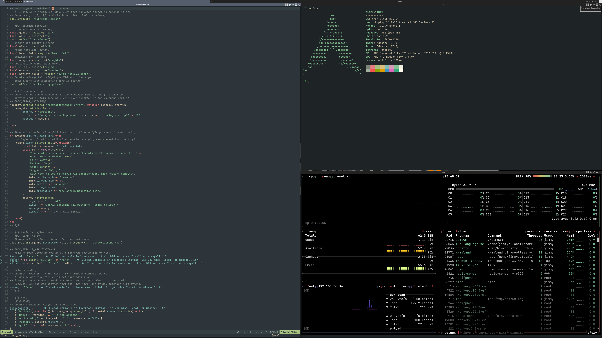
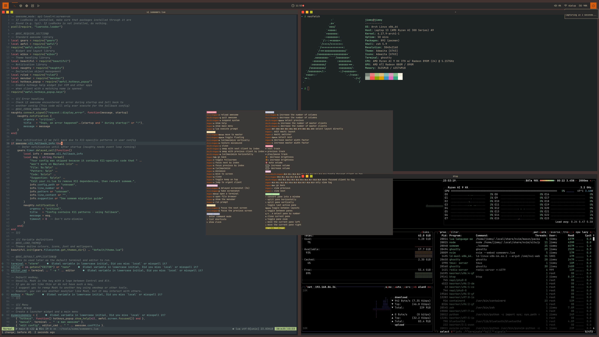

# somewm

A Lua framework for building your Wayland desktop. Layouts, widgets, keybindings, window rules, notifications, status bars, etc.

SomeWM has a complete widget system, a signal-driven object model, and a compositor runtime, all wired together so every piece can talk to every other piece. Write a widget that reacts to window focus changes. Build a layout that adapts to screen geometry. Script your entire workflow from `rc.lua` or from the command line.

Built on [wlroots](https://gitlab.freedesktop.org/wlroots/wlroots) 0.20.2, built from source as part of the somewm build. Runs [AwesomeWM](https://github.com/awesomeWM/awesome) configs: keybindings, rules, themes and the stock widgets carry over.

> **This branch (`main`) is SomeWM 2.x.** Widgets that draw themselves (their own `fit` or `draw`, often built with `wibox.widget.base.make_widget`), `wibox.hierarchy` and the textbox measuring functions were removed in 2.1. If your config needs them, use SomeWM 1.4. See [Choosing a version](#choosing-a-version).

<p align="center">
  
  
</p>
<p align="center">
  <em>Default config (left) and a styled config (right)</em>
</p>

## Choosing a version

|  | 1.4 | 2.x |
| --- | --- | --- |
| Branch | [`release/1.4`](https://github.com/trip-zip/somewm/tree/release/1.4) | `main` |
| AUR | [`somewm`](https://aur.archlinux.org/packages/somewm) | `somewm-git` |
| Lua API | AwesomeWM's, follows AwesomeWM master | AwesomeWM's, minus what 2.1 removed |
| Receives | Crash fixes, build fixes, AwesomeWM ports | Features and fixes |

Use 1.4 if your config has widgets with their own `fit` or `draw`, walks `wibox.hierarchy`, or measures text with `textbox:get_preferred_size`. On 2.x such a widget is left out and the log names it. Otherwise use 2.x. The [2.0 to 2.1 upgrade guide](https://somewm.org/docs/next/getting-started/upgrading-from-2.0/) lists everything that was removed.

Only the newest 2.x release gets fixes. 2.0 ended at 2.0.1. `somewm-git` builds `main` and moves to each new 2.x release when it lands, including releases that remove API.

## Install

**Arch Linux (AUR):**
```bash
yay -S somewm      # 1.4
yay -S somewm-git  # 2.x, builds main
```

**From source:**
```bash
git clone https://github.com/trip-zip/somewm
cd somewm
make
sudo make install
```

For Debian, Fedora, NixOS, and detailed instructions, see the [Installation Guide](https://somewm.org/docs/next/getting-started/installation).

**wlroots.** The build downloads wlroots 0.20.2 and builds it into somewm, so no wlroots package is needed. wlroots needs wayland 1.24.0, libdrm 2.4.129, xkbcommon 1.8.0, pixman 0.46.0 and wayland-protocols 1.47 or newer. If your system has those, nothing else is built. Each one that is older is downloaded at a fixed version and built alongside wlroots. Debian 13 builds all five this way; Ubuntu 24.04 builds those five and libdisplay-info.

**XWayland.** XWayland support is always built in, so xcb, xcb-icccm and Xwayland are required to build. X11 applications need the Xwayland binary at runtime.

## Run

From a TTY:
```bash
dbus-run-session somewm
```

From a display manager, select "somewm" as your session.

Systemd units are also included for session management.

Validate your config before switching:
```bash
somewm --check
```

See [First Launch](https://somewm.org/docs/next/getting-started/first-launch) for configuration and migrating from AwesomeWM.

## Documentation

Full documentation at **[somewm.org](https://somewm.org)**:

- [Getting Started](https://somewm.org/docs/next/getting-started/installation) - Installation, first launch, migration
- [Tutorials](https://somewm.org/docs/next/tutorials/basics) - Keybindings, widgets, themes
- [Wayland Protocols](https://somewm.org/docs/next/reference/wayland-protocols) - Protocols somewm advertises to clients
- [Troubleshooting](https://somewm.org/docs/next/troubleshooting) - Common issues and solutions

## Contributing

Contributions welcome! Please read the [Contributing Guide](CONTRIBUTING.md) first.

- Report bugs or request features via [Issues](https://github.com/trip-zip/somewm/issues)
- Questions and discussion at [Discussions](https://github.com/trip-zip/somewm/discussions)

## Acknowledgements

- [AwesomeWM](https://github.com/awesomeWM/awesome) - The GOAT window manager
- [wlroots](https://gitlab.freedesktop.org/wlroots/wlroots) - The Wayland compositor library
- [dwl](https://codeberg.org/dwl/dwl) - Initial reference for wlroots integration

## License

GPLv3. See [LICENSE](LICENSE) for details.
